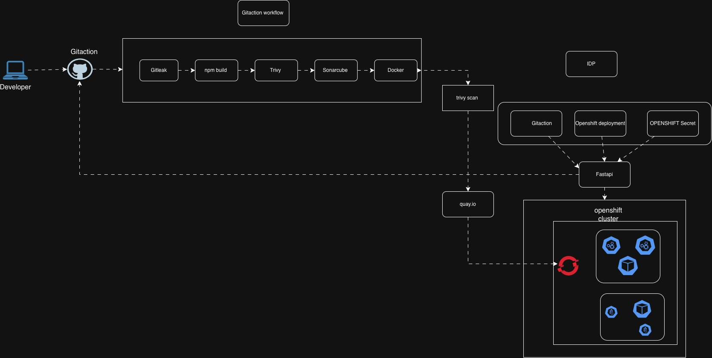

# OpenShift Platform Automation

**A Python-based platform engineering project exploring OpenShift deployment automation, application lifecycle management, containerization, and CI/CD integration.**

This repository brings together application deployment manifests, Python-based automation interfaces, container build workflows, and OpenShift operational commands to demonstrate how repetitive application management tasks can be simplified through automation.

The project explores how developers and platform engineers can interact with OpenShift resources through a web interface and automate application delivery using GitHub Actions.

---

## Table of Contents

- [Project Overview](#project-overview)
- [Architecture](#architecture)
- [Project Capabilities](#project-capabilities)
- [Technology Stack](#technology-stack)
- [Application Components](#application-components)
- [CI/CD Workflows](#cicd-workflows)
- [OpenShift Deployment](#openshift-deployment)
- [Local Development](#local-development)
- [Configuration](#configuration)
- [Repository Structure](#repository-structure)
- [Project Demonstration](#project-demonstration)

---

## Project Overview

Managing workloads on Kubernetes and Red Hat OpenShift involves several operational activities, including deploying applications, managing configurations, scaling workloads, inspecting logs, and exposing services.

These operations are frequently performed through the OpenShift CLI (`oc`) and declarative YAML manifests.

This project explores a more accessible approach by introducing Python-based automation interfaces and CI/CD workflows that simplify common operational activities.

The repository contains:

- A Python-based OpenShift automation API built with FastAPI.
- A web interface for interacting with OpenShift automation endpoints.
- OpenShift deployment manifests for application workloads.
- Docker-based application packaging.
- GitHub Actions workflows for testing, security scanning, image publishing, and deployment automation.
- Quay.io integration for container image distribution.

The project demonstrates practical concepts associated with DevOps automation and platform engineering.

---

## Architecture

The architecture diagram illustrates the intended integration between the application components, automation layer, container registry, CI/CD workflows, and OpenShift environment.



### Architecture Components

| Component | Responsibility |
|---|---|
| Python Application | Provides application functionality and automation interfaces |
| FastAPI | Exposes API endpoints for OpenShift operational tasks |
| OpenShift CLI (`oc`) | Executes cluster management operations |
| Docker | Packages the application into container images |
| GitHub Actions | Automates testing, scanning, image building, and deployment workflows |
| Quay.io | Stores and distributes container images |
| Red Hat OpenShift | Runs and manages containerized workloads |
| Kubernetes/OpenShift YAML | Defines application deployments and supporting resources |

---

## Project Capabilities

### 1. OpenShift Operational Automation

The FastAPI component contains endpoints designed to automate common OpenShift operations.

These include:

- Applying Kubernetes and OpenShift YAML manifests.
- Triggering OpenShift builds.
- Retrieving application Routes.
- Exposing Services through OpenShift Routes.
- Scaling application deployments.
- Retrieving application logs.
- Deploying container images with ConfigMaps and Secrets.
- Configuring environment variables and volume mounts.

The automation layer executes OpenShift CLI commands programmatically and returns command output and execution status.

### 2. Application Deployment

The repository includes declarative OpenShift resources for deploying applications.

The manifests cover:

- Deployments
- Services
- Routes
- ConfigMaps
- Secrets
- ImageStreams
- BuildConfigs

These resources demonstrate how applications can be deployed and exposed within an OpenShift project.

### 3. Containerization

Docker is used to package the Python application and its dependencies into a portable container image.

The repository includes a Dockerfile based on Python 3.12 Slim.

Containerization provides a consistent runtime environment across development and deployment environments.

### 4. CI/CD Automation

GitHub Actions is used to automate the application delivery lifecycle.

The workflows contain stages for:

- Source code checkout.
- Python dependency installation.
- Automated testing using Pytest.
- Filesystem vulnerability scanning using Trivy.
- Docker image building.
- Container image vulnerability scanning.
- Publishing images to Quay.io.
- OpenShift authentication.
- Deployment automation.

### 5. Application Dashboard

The repository contains web interfaces for application interaction and operational automation.

The OpenShift automation interface provides access to operations such as deployment, scaling, log retrieval, and configuration management.

---

## Technology Stack

| Category | Technology |
|---|---|
| Programming Language | Python 3.12 |
| API Framework | FastAPI |
| Additional Application Framework | Flask |
| Frontend | HTML, CSS, JavaScript |
| Containerization | Docker |
| Container Registry | Quay.io |
| Container Orchestration | Red Hat OpenShift |
| Cluster Management | OpenShift CLI (`oc`) |
| CI/CD | GitHub Actions |
| Configuration Management | Kubernetes YAML |
| Deployment Management | Kustomize |
| Security Scanning | Trivy |
| Automated Testing | Pytest |
| Version Control | Git and GitHub |

---

## Application Components

The repository currently contains two Python application entry points.

### FastAPI OpenShift Automation Component

Location:

`fastapi_app/`

This component contains the automation API and supporting utilities.

The API uses the OpenShift CLI to execute cluster operations.

The dashboard interface is located in:

`statics/index.html`

The supporting automation utility is responsible for executing commands and returning their standard output, errors, and exit status.

### Flask Application

Location:

`app.py`

This component contains a Flask-based CryptoVault demonstration application with mock cryptocurrency data, market statistics, and historical price endpoints.

Its interface is located in:

`templates/index.html`

The root Dockerfile currently starts this Flask application.

**Implementation note:** The FastAPI automation component and Flask application are separate entry points in the current repository. The existing Dockerfile packages the Flask application, not the FastAPI automation API.

---

## CI/CD Workflows

The repository contains two GitHub Actions workflow definitions.

### Workflow 1: Docker Image CI/CD

Location:

`.github/workflows/docker-image.yml`

This workflow is configured to run on pushes to the `main` and `develop` branches and pull requests targeting `main`.

The workflow contains the following stages:

| Stage | Implementation |
|---|---|
| Source Checkout | GitHub Actions checkout |
| Python Setup | Python 3.12 |
| Dependency Installation | pip |
| Automated Testing | Pytest |
| Filesystem Scanning | Trivy |
| Container Build | Docker Buildx |
| Image Scanning | Trivy |
| Image Publishing | Quay.io |
| Cluster Authentication | OpenShift CLI |
| Deployment | Kustomize and `oc apply` |
| Rollout Verification | `oc rollout status` |

The configured container image is:

`quay.io/ubiowororuki/mypython-app:latest`

The target OpenShift namespace is:

`ubiowororuki-dev`

### Workflow 2: OpenShift Deployment Automation

Location:

`.github/workflows/openshift_deploy.yaml`

This workflow is configured to support:

- Manual execution through `workflow_dispatch`.
- Automatic execution following pushes to `main`.
- Python application testing.
- Trivy filesystem scanning.
- Docker image building and publishing.
- OpenShift authentication.
- Triggering an OpenShift BuildConfig webhook.

The configured image is:

`quay.io/ubiowororuki/fastapi-app:latest`

The BuildConfig webhook is associated with the `myapp-dev` application in the `ubiowororuki-dev` namespace.

These are two separate delivery approaches maintained in the repository.

---

## OpenShift Deployment

The repository provides two sets of deployment manifests.

### Kustomize Deployment

Location:

`kustomized/`

The Kustomize configuration groups the application resources into a single deployment definition.

Included resources:

- `deployment.yaml`
- `service.yaml`
- `route.yaml`
- `kustomization.yaml`

The configured deployment uses four replicas and exposes the application on port 5000.

#### Prerequisites

- Access to a Red Hat OpenShift cluster.
- OpenShift CLI installed.
- Authentication credentials.
- An accessible container image in Quay.io.
- The target OpenShift namespace created.

#### Authenticate with OpenShift

```bash
oc login https://<OPENSHIFT_API_URL>:6443 \
  --token=<OPENSHIFT_TOKEN>
```

#### Create or select the project

```bash
oc new-project ubiowororuki-dev
```

If the project already exists:

```bash
oc project ubiowororuki-dev
```

#### Deploy using Kustomize

```bash
oc apply -k kustomized/
```

#### Verify deployment resources

```bash
oc get deployments -n ubiowororuki-dev

oc get pods -n ubiowororuki-dev

oc get services -n ubiowororuki-dev

oc get routes -n ubiowororuki-dev
```

#### Verify application rollout

```bash
oc rollout status deployment/mypython-app \
  -n ubiowororuki-dev
```

### Direct Manifest Deployment

The `Openshift/` directory also contains individual OpenShift resource definitions.

To apply these manifests:

```bash
oc apply -f Openshift/ \
  -n ubiowororuki-dev
```

Check the created resources:

```bash
oc get all -n ubiowororuki-dev
```

---

## Local Development

### Prerequisites

- Python 3.12
- Git
- Docker
- pip
- Pytest

### 1. Clone the repository

```bash
git clone https://github.com/smogalloyubio/openshift-platform-automation.git

cd openshift-platform-automation
```

### 2. Create a virtual environment

```bash
python3 -m venv venv

source venv/bin/activate
```

### 3. Install the Flask application dependencies

```bash
pip install -r requirements.txt
```

### 4. Run the Flask application

```bash
python app.py
```

The application listens on:

```text
http://localhost:5000
```

### 5. Run automated tests

```bash
pytest tests/ -v
```

The existing test suite validates the Flask application, including its dashboard, API responses, cryptocurrency history endpoints, and health endpoint.

---

## Docker Containerization

The root Dockerfile packages the Flask application.

### Build the image

```bash
docker build -t openshift-platform:latest .
```

### Run the container

```bash
docker run -d \
  --name openshift-platform \
  -p 5000:5000 \
  openshift-platform:latest
```

### Verify the running container

```bash
docker ps
```

### Inspect application logs

```bash
docker logs openshift-platform
```

### Stop the container

```bash
docker stop openshift-platform
```

---

## Configuration

The GitHub Actions workflows reference repository secrets for authentication and deployment.

The configured secrets include:

| Secret | Purpose |
|---|---|
| `QUAY_USERNAME` | Quay.io authentication username |
| `QUAY_TOKEN` | Quay.io access token |
| `OPENSHIFT_SERVER` | OpenShift API endpoint |
| `OPENSHIFT_TOKEN` | OpenShift authentication token |
| `WEBHOOK_SECRET` | BuildConfig webhook authentication |

Configure these values under:

**GitHub Repository → Settings → Secrets and variables → Actions**

Do not commit credentials, access tokens, webhook secrets, or other sensitive configuration values to source control.

---

## Repository Structure

```text
openshift-platform-automation/
│
├── .github/
│   └── workflows/
│       ├── docker-image.yml
│       └── openshift_deploy.yaml
│
├── ArchitectureDiagram/
│   ├── _openshiftnewapp.jpg
│   └── openshift cluster.jpg
│
├── Openshift/
│   ├── buildconfig.yaml
│   ├── configmap.yaml
│   ├── deployment.yaml
│   ├── imagestream.yaml
│   ├── route.yaml
│   ├── secret.yaml
│   └── service.yaml
│
├── fastapi_app/
│   ├── main.py
│   └── utils.py
│
├── kustomized/
│   ├── deployment.yaml
│   ├── service.yaml
│   ├── route.yaml
│   └── kustomization.yaml
│
├── screenshoot/
│   ├── Copilot_20260525_095756.png
│   ├── Copilot_20260525_095822.png
│   ├── Copilot_20260525_095834.png
│   ├── argocdimage.jpg
│   └── ...
│
├── static/
│   ├── css/
│   └── js/
│
├── statics/
│   └── index.html
│
├── templates/
│   └── index.html
│
├── tests/
│   └── test_app.py
│
├── app.py
├── Dockerfile
├── requirements.txt
├── Dedeployment_command.md
└── README.md
```

---

## Project Demonstration

### Application Dashboard


### OpenShift Deployment


### GitHub Actions CI/CD Pipeline


### Video Demonstration

[Watch the project demonstration](https://drive.google.com/file/d/1zCL85bGMT5S07hPlfglaOFpvnUr9YoVX/view?usp=sharing)

---

## Engineering Focus

This project explores practical implementation of:

- OpenShift application lifecycle management.
- Python-based infrastructure and platform automation.
- Container image building and publishing.
- Declarative Kubernetes and OpenShift deployments.
- CI/CD workflow design.
- Container vulnerability scanning.
- Application scaling and operational management.
- GitOps-oriented deployment configuration.

**Repository:** https://github.com/smogalloyubio/openshift-platform-automation

**Author:** Rukevwe Ubioworo
